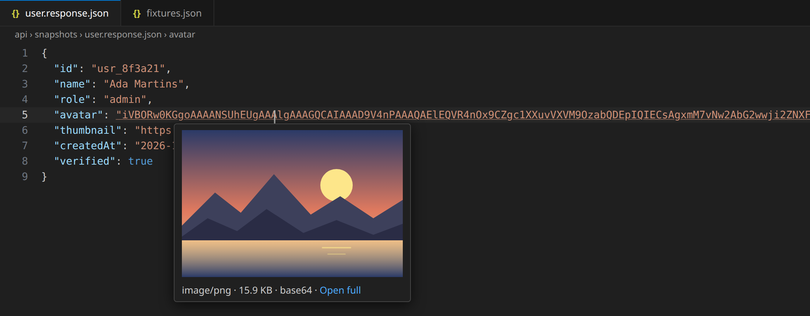

<p align="center"></p>

# Inline Image Preview

Hover a base64 string, a `data:` URI, or an image URL in any file and see the
picture right there. Useful for API responses, JSON fixtures, logs, test
snapshots, database dumps, and any code that has images inline.



## What it recognizes

- **Raw base64.** No `data:` prefix needed. JPEG, PNG, GIF, WebP, BMP, ICO,
  and SVG are recognized by their first bytes, so a bare `"iVBORw0KGgo…"` or
  `"/9j/…"` field works.
- **Data URIs.** `data:image/png;base64,…`
- **Image URLs.** Links ending in `.png`, `.jpg`, `.webp`, `.svg`, and so on.
  Links without an extension (CDN, S3, and signed URLs) are checked by their
  `Content-Type`, and links to obvious non-images (`.html`, `.json`, …) are
  never fetched.

Works in every language and file type, including untrusted workspaces.

## Features

- **Hover preview.** Shows a thumbnail up to 300 px with the type, size, and
  where the image came from.
- **Open full.** The link in the hover opens the full-size image in a preview
  tab beside the editor, on a checkerboard so transparency is visible.
- **Command.** *Image Preview: Preview Selection / String* in the Command
  Palette previews the current selection, the string under the cursor, or a
  string you paste.
- **Handles big images.** Images are written to a temp folder
  (`$TMPDIR/vscode-inline-image-preview/`) and shown from there, so multi-MB
  base64 blobs render too. The limit is 16 MB per image.

## Settings

| Setting | Default | Description |
| --- | --- | --- |
| `imagePreview.previewUrls` | `true` | Preview http(s) image URLs on hover. This fetches the URL; turn it off to keep hovers from making network requests. |

URL fetches time out after 6 seconds and results are cached for the session.

## Development

No build step: the editor runs `extension.js` and `src/` directly.

```bash
npm install          # jimp, used for thumbnails
npm test             # detection logic against sample payloads
./install.sh         # symlink into VSCode/Cursor for live editing
npm run package      # build the .vsix
```

Press <kbd>F5</kbd> to open a development window with `samples/` loaded.
`node scripts/images.js` regenerates the icon and the README screenshot.
Publishing steps are in [`PUBLISHING.md`](./PUBLISHING.md).

## License

MIT
