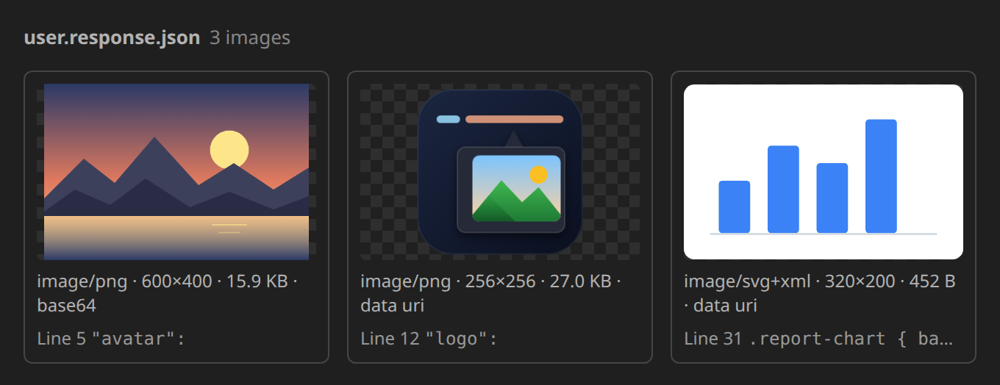

<p align="center"></p>

# Inline Image Preview

Hover a base64 string, a `data:` URI, or an image URL in any file and see the
picture right there. Useful for API responses, JSON fixtures, logs, test
snapshots, database dumps, and any code that has images inline.


## What it recognizes

- **Raw base64.** No `data:` prefix needed. JPEG, PNG, GIF, WebP, BMP, ICO,
  and SVG are recognized by their first bytes, so a bare `"iVBORw0KGgo…"` or
  `"/9j/…"` field works.
- **Data URIs.** `data:image/png;base64,…`
- **Image URLs.** Links ending in `.png`, `.jpg`, `.webp`, `.svg`, and so on.
  Links without an extension (CDN, S3, and signed URLs) are checked by their
  `Content-Type`, and links to obvious non-images (`.html`, `.json`, …) are
  never fetched.

Works in every language and file type, including untrusted workspaces.

## Features

- **Hover preview.** Shows a thumbnail with the image type, pixel size
  (`600×400`), file size, and where the image came from.
- **Hover actions.**
  - *Open full* opens the full-size image in a tab beside the editor, on a
    checkerboard so transparency is visible.
  - *Save* writes the image to a file.
  - *Data URI* and *Base64* copy the image in either form, so you can convert
    a raw base64 field to a data URI or back.
  - *External* opens the image in your system's image viewer.
- **All images in a file.** *Image Preview: Show All Images in File* opens a
  grid of every image in the file, with its line and key. Click one to jump to
  it. The grid follows your edits.

  

- **Gutter thumbnails.** Turn on `imagePreview.gutterThumbnails` (or run
  *Image Preview: Toggle Gutter Thumbnails*) to see a small thumbnail next to
  every line that has a base64 or data URI image.
- **Images to base64.**
  - *Paste* a screenshot into any file to insert it as a data URI.
  - *Drop* an image file into the editor, then pick *Insert image as data URI*
    or *as base64* from the drop menu. Dropping still inserts the file path by
    default, and pasting text works as before.
  - *Image Preview: Insert Image as Base64…* inserts image files you pick, or
    replaces a selected image path (like `./assets/logo.png`) with the image.
  - Right-click an image in the Explorer → *Copy as Data URI*.
- **Command.** *Image Preview: Preview Selection / String* previews the
  current selection, the string under the cursor, or a string you paste.
- **Handles big images.** Images are written to a temp folder and shown from
  there, so multi-MB base64 blobs render too (up to 16 MB per image). Each
  window's temp files are deleted when it closes.

## Settings

| Setting | Default | Description |
| --- | --- | --- |
| `imagePreview.previewUrls` | `true` | Preview http(s) image URLs on hover. This fetches the URL; turn it off to keep hovers from making network requests. |
| `imagePreview.gutterThumbnails` | `false` | Show a thumbnail in the gutter next to lines with a base64 or data URI image. |
| `imagePreview.insertFormat` | `dataUri` | `dataUri` or `base64`: what *Insert Image* produces, and which option paste and drop offer first. |
| `imagePreview.pasteAndDrop` | `true` | Offer the data URI and base64 options when you paste or drop images. |

URL fetches time out after 6 seconds and results are cached for the session.

## Development

No build step: the editor runs `extension.js` and `src/` directly.

```bash
npm install          # dev tools only; the extension has no dependencies
npm test             # detection and image-size logic
npm run test:integration   # hover and commands inside a real VS Code
./install.sh         # symlink into VSCode/Cursor for live editing
npm run package      # build the .vsix
```

Press <kbd>F5</kbd> to open a development window with `samples/` loaded.
`node scripts/images.js` regenerates the icon and the README screenshots.
Publishing steps are in [`PUBLISHING.md`](./PUBLISHING.md).

## License

MIT
